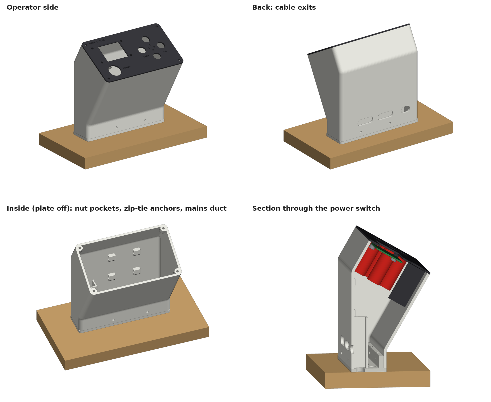

# HMI enclosure v1: sloped stand for the front panel

A 150 mm tall stand for the v2 front panel (screen, four arrow keys, power switch). It fits the 40 × 140 mm free spot on the wooden base.

- **Face angle:** the panel leans back 60° from vertical, so it sits 30° above horizontal, like a desk console.
  - 60° is the most the 40 mm footprint allows. Any steeper and the underside of the head would run into the foot.
  - The top edge of the panel is 150 mm above the wood. The head overhangs the base by 49 mm toward the operator.
- **Two printed parts in white PLA:**
  - **Foot:** a 4 mm plate with a plug. Screw it to the wood first.
  - **Tower:** drops over the plug and is held by 4 × M3 screws.
- The v2 front panel screws onto the face with 4 × M3 screws into nut pockets behind the corners.

Everything is in `Documents\Strip_Cutter\v3`:

| What | Where |
|---|---|
| Bambu project (1 plate, sliced, not started) | `print_STL_hmi_enclosure_v1\HMI_enclosure_v1_A1.3mf` (sliced copy: `HMI_enclosure_v1_A1.gcode.3mf`) |
| STLs (print orientation) | `print_STL_hmi_enclosure_v1\HMI_enclosure_tower.stl`, `HMI_enclosure_foot.stl` |
| CAD | `HMI_enclosure_v1_assembly.step`: tower, foot and front panel in place. Open it in Fusion with **File → Open → Open from my computer**. There are also separate `HMI_enclosure_tower.step` and `HMI_enclosure_foot.step`. Script: `cad\hmi_enclosure.py` |

## Plate settings

| Setting | Value |
|---|---|
| Printer, nozzle | A1, 0.6 mm |
| Filament | WOL3D PLA PRO+ white, using Generic PLA with the temperatures changed |
| Nozzle | 230 °C (from the spool label) |
| Plate | Textured PEI, 55 °C |
| Profile | 0.30 mm Strength |
| Walls | 5, so the 3 mm walls print solid |
| Supports | none. Every slope is 60° from horizontal or steeper. |
| Brim | outer and inner, 8 mm, because the tower stands 146 mm tall on a thin rim |
| Time, filament | 5 h 39 min, 236 g |

**Orientation:** the tower prints standing up, as it will stand on the machine. The foot prints flat.

**After printing:** peel the brim off inside the bottom opening of the tower and inside the foot. Otherwise the tower will not slide over the plug.

## Hardware

| Qty | Part | For |
|---|---|---|
| 4 | Countersunk wood screw, 3.5–4 mm × 16–20 mm | Foot to the wooden base |
| 4 | M3 × 10 screw (pan or button head) + M3 nut | Tower to foot |
| 4 | M3 × 12 screw (pan or button head) + M3 nut | Front panel to tower |
| A few | Zip ties, up to 3.6 mm wide | Wire bundles, on the anchors inside the back wall |

## Wiring paths

- **Mains (power switch):**
  - A closed duct runs at the back-left corner (the operator's left), from the bottom up to 62 mm.
  - The switch wires drop into the top of the duct.
  - They come out through the left slot in the back wall, or through the 10 mm hole in the foot. To use the hole, drill the wood under it.
  - Inside the stand, the mains wires stay apart from the screen and button wires.
- **Low voltage (screen and four buttons):**
  - These wires run down the open post.
  - They leave through the two slots in the back wall, 28 × 10 mm each, or through the 46 × 10 mm slot in the foot.
- **Zip-tie anchors:** four anchors on the inside of the back wall, at 52 mm and 88 mm up, hold the wire bundles in place.

## Fitting

1. Drop 4 M3 nuts into the slots at the top of the foot's plug, two at the front and two at the back.
2. Screw the foot to the wood with the 4 wood screws. Put the notch in the plug at the back-left, where the mains duct comes down.
   - If the wires will go down through the base, drill the wood under the foot's holes now.
3. Run the wires from the panel parts down through the tower and out of the back slots before you lower it.
4. Lower the tower over the plug. Fit 4 × M3 × 10 through the front and back walls into the nuts.
5. Press 4 M3 nuts into the pockets behind the face corners. They are a snug fit, and a drop of glue holds them if needed.
6. Connect the screen, buttons and switch, then fix the front panel with 4 × M3 × 12.

## Checks done on the model

- **Interference:** the front panel and these stand-ins were checked against the tower. None of them touch it.
  - Stand-ins: screen board and its plug, button bodies Ø16 × 42 mm, power switch Ø22 × 46 mm.
  - Smallest gap: 2.4 mm, at the screen board corner.
- **Joint:** the foot and tower do not overlap. The plug has 0.25 mm clearance.
- **Print check:** a layer-by-layer check of both STLs found no floating islands. Both meshes are closed.
